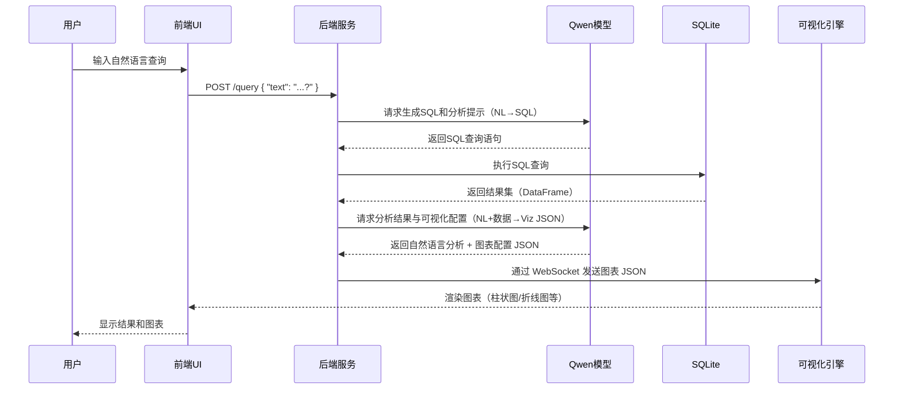

# 执行摘要

本文设计一个本地运行的“一站式数据分析系统”，用户以自然语言提问，系统自动分析数据并智能可视化呈现。系统核心采用**Qwen 在线大模型 API**生成 SQL 查询和分析建议，数据存储层使用 **SQLite**。设计重点包括：自然语言解析与 NL→SQL 转换方案；语义解析与检索增强生成（RAG）；大模型 Agent 协调与工具调用；Prompt 设计与推理链模式；是否使用向量数据库等技术选型的利弊；企业级 AI Agent 框架比较（如 LangChain、LlamaIndex、Haystack、BentoML、Ray Serve 等）；可本地运行的开源示例项目（如 Chat2DB、Vanna、NL2SQL 等）；前后端技术栈与部署策略；系统架构与数据流程图；安全性能与可维护性建议；开发里程碑与交付清单。

核心技术方面，我们综合了 NL→SQL（或 NL→API/Code）方法以及链式思维（Chain-of-Thought）、提示工程、Prompt 与少样本等策略。Agent 架构支持多工具调用、RAG 语义搜索和内置“工具函数”，可根据场景选择是否引入本地向量库用于语义检索。我们还比较了常用框架的特点与适用场景，并列出成熟开源项目示例，给出后端（Python/FastAPI、SQLite、QLLM模块、Agent 管理、缓存和向量存储）和前端（前端框架、ECharts/D3/Plotly 实时可视化、WebSocket 实时推送）技术选型建议。文末通过 Mermaid 图示说明系统组件关系和典型调用序列（自然语言输入→解析→生成SQL→执行查询→数据分析→生成可视化配置→前端渲染）。此外，提供了 SQL 注入防护、权限控制、并发与缓存、成本延迟优化、日志监控和测试策略等安全与可维护性建议，以及基于单机小规模并发环境的项目开发里程碑、验收标准和时间人员估算。

# 核心技术与方法

- **自然语言转SQL（NL→SQL）**：将用户提问直接映射为结构化查询语言（SQL）。优点：利用数据库标准查询，路径最短，数据权限与类型清晰。缺点：对数据库模式和关系复杂度敏感；大模型生成的SQL可能语法或逻辑不严谨。适用场景：已知固定关系型数据，需求偏向报表查询时最直接。实现要点：使用基于 Transformer 的语义解析器（如 RAT-SQL、PICARD 等），或通过模板化 Prompt 调用大模型生成 SQL。例程：在 Prompt 中包含数据库模式及示例，或使用 API Format 调用 Qwen 生成 SQL，然后用 Python `sqlite3` 执行：

  ```python
  prompt = f"已知数据表模式...，请将下面问题转换为SQL：{user_question}"
  response = requests.post(
      "https://api.qwen.ai/v1/chat/completions",
      headers={"Authorization": f"Bearer {API_KEY}"},
      json={"model": "qwen-7b", "messages": [{"role": "user", "content": prompt}]}
  )
  generated_sql = response.json()["choices"][0]["message"]["content"]
  conn = sqlite3.connect("data.db")
  results = conn.execute(generated_sql).fetchall()
  ```

- **语义解析与 RAG（检索增强生成）**：先检索相关知识或上下文，再生成答案。优点：补足大模型知识库盲区，适用于资料问答或多表多库场景；提供可溯源来源片段。缺点：需维护索引或向量库，系统复杂度增加，检索结果噪声可能误导生成。场景：大文档、业务规范、或需要解释分析依据时有效。实现要点：在后端使用向量数据库（如 Chroma、Weaviate）存储文档/模式嵌入，查询最相关的上下文片段，把检索结果和用户问题一起输入大模型生成答案。示例流程：用户提问 → 后端生成问向量 → 向量搜索相关文档摘要 → 将摘要与问题共同作为 Prompt 给 Qwen → 输出可能含解释性答案或相关SQL。

- **Agent 编排与工具调用**：通过“智能体”机制，令模型在推理时决定调用哪个“工具”。工具可包括：数据库查询函数、可视化生成函数、缓存接口等。优势：将复杂任务分解为多步，允许模型自主决定流程和调用实际函数；结合观察（链式思考）+动作（工具调用）提高完成复杂分析任务的能力。缺点：实现较复杂，需要定义工具接口、保证安全执行，并防止无限循环。场景：需要多阶段交互或组合功能时，如先查询，再处理，再生成报告。实现要点：设计“工具”接口（如 NL2SQL 工具、图表生成工具）、用系统Prompt或函数调用指引模型何时调用。示例：在大模型 Prompt 或 API 请求中使用类似 OpenAI Function Calling 方式，让 Qwen 输出 JSON 格式指令（如调用 `execute_sql(sql)` 或 `generate_chart(data)`）。

- **链式思维（Chain-of-Thought）提示**：让模型生成步骤化推理过程以提高复杂任务性能。优点：显著提升推理和细节问题回答准确率，尤其在数学、逻辑推理、复杂SQL生成场景中有效。缺点：生成内容较冗长，可能引导到不必要的逻辑环，增加计算成本。适用场景：SQL 生成时可引导模型逐步映射表与条件；复杂数据分析时让模型先思考分析逻辑。实现要点：在 Prompt 中加入类似“让我们分步思考”示例；使用 few-shot demonstrations 包含思路解释。示例：在 Prompt 前加上“先用思维链分析：...，然后给出最终SQL”。

- **提示工程（Prompt Engineering）**：设计恰当 Prompt（包括系统指令、few-shot示例、限制语等）以引导模型输出预期格式和内容。优点：无需额外训练即可快速适应特定任务；按需调整案例可显著提升准确率。缺点：需要多次实验调整示例和指令；对大模型抽象语义控制有限。场景：所有大模型调用环节都需重视 Prompt。要点：提供清晰任务说明、约束输出格式；对 SQL 生成，可给出多个示例对照；对可视化配置，明确输出结构（如 ECharts/Plotly 配置 JSON 模板）。示例：Prompt 开头说明“你是数据库助手，将返回符合指定格式的JSON或SQL”。

- **微调/指令调优/少样本学习**：如果本地允许，可考虑对大模型进行微调（fine-tuning）或指令调优（如LLaMA/ChatGLM的LoRA/PEFT调优）以适应业务领域。优点：可显著提高领域数据与问答准确性。缺点：需要数据、算力和持续维护；在线API模式下受限于服务商是否支持。少样本学习（few-shot）通过在 Prompt 中给出少量示例支持任务；优势是无需训练直接改善答案风格，劣势是对长Prompt有Token限制且示例可覆盖场景有限。场景：特殊领域（企业业务语义、表名复杂）推荐尝试；若使用纯API则主要靠 few-shot 在 Prompt 中进行。示例：提供 3~5 对“问题→SQL”示例给 Qwen。

- **向量数据库**：用于存储文本/Embed 做相似检索。优点：高效语义检索，支持 RAG，如快速查找相关数据库模式说明或历史查询结果；加速常见问题回答。缺点：增加系统复杂度和维护成本（需构建和更新索引），对小规模 SQLite 数据场景可能无需。适用场景：若有大量文档、日志或想缓存历史问答，可用如 Chroma、Weaviate、Pinecone（企业版）等。本地部署可选开源Chroma。实现要点：将需要检索的内容（如表字段说明、用户历史问题）编码后存入向量库，通过质心搜索获取Top-K相关文本作为生成额外上下文。示例流程：用户提问前先检索最相关的Schema说明或FAQ，连同问题一起输入LLM。


# 企业常用 Agent 开发框架比较

下面对比几种主流 AI Agent 框架/平台，帮助选型：

| 框架/平台      | 支持语言/平台         | 工具调用能力                       | 状态管理与记忆       | 并发扩展性           | Qwen API 集成难易度     | 社区活跃度       | 许可协议       | 本地部署适合度                    |
|---------------|----------------------|-----------------------------------|----------------------|----------------------|-----------------------|-----------------|---------------|----------------------------------|
| **LangChain** | Python (主)           | 内置多种 Tool 和 Agent 模型      | 支持 Memory 模块（对话历史记忆） | 依赖 Python，可结合异步扩展；单机可扩大量 | 易（可当作 OpenAI 兼容接口使用） | 非常活跃（GitHub 星数上万） | MIT           | 可本地部署（纯 Python 库）       |
| **LlamaIndex（GPT Index）** | Python    | 聚焦构建检索索引，Tool 功能较少   | 内置文档存储和记忆机制   | 依赖单机处理与向量库，规模受限   | 易（同样可调用任意 LLM API）   | 活跃（持续更新） | MIT           | 适合本地部署，小型数据集最佳    |
| **Haystack (deepset)** | Python      | 强大 RAG 管道，支持 Retriever/Reader 等 | 内置对话与管道管理      | 原生支持多进程，可水平扩展    | 中等（支持多模型后端，需对接 Qwen API） | 活跃（企业应用广泛） | Apache 2.0    | 适合本地部署，特别擅长文档检索场景 |
| **BentoML**   | Python、部署容器   | 主要用于模型打包与服务，Tool 功能需自定义 | 无内置对话记忆（聚焦部署）  | 原生支持高并发、GPU 批量      | 高（作为独立服务包装 Qwen 调用） | 较活跃（社区规模中等） | Apache 2.0    | 本地/私有云皆可，用于高性能服务  |
| **Ray Serve** | Python            | 通用服务框架，可部署任何 Python 函数/ML 模型 | 无专门记忆管理，但有状态服务功能 | 强大（基于 Ray 分布式可扩展） | 易（自定义服务可调用 Qwen）    | 活跃（Ray 项目广泛使用） | Apache 2.0    | 适合本地大规模并发部署         |

**细节说明：**  
- **工具调用能力**：LangChain 本身提供丰富的内置工具和 Agent 模式，方便快速开发；Haystack 着重检索生成管线，但需要组合多节点；LlamaIndex 则是构建索引和检索，不自带通用 Agent 逻辑。BentoML 和 Ray Serve 本质是模型部署服务，可将 Qwen API 或自定义代码封装为可扩展服务，但没有预置 Agent 逻辑。  
- **状态管理**：LangChain 包含 Memory（记忆）模块可存储会话历史；LlamaIndex 聚焦文档索引；Haystack 支持简单的对话历史；BentoML/Ray 本身不专注对话记忆，需要开发者自己维护（例如使用 Redis 缓存）。  
- **并发与扩展**：Ray Serve 是专为大并发设计，适合托管多模型；BentoML 也有进程和批量支持；LangChain/Llama/Haystack 需结合异步框架或部署多个实例来扩展。  
- **Qwen 集成**：如果 Qwen 提供 OpenAI 兼容接口，LangChain 和上述框架通过配置 OpenAI 接口即可调用；否则可能需自定义接入。LangChain 等生态文档较多，可快速找到示例（如调用 ChatOpenAI 替换为 Qwen）。  
- **社区与许可**：LangChain 及 Ray 社区活跃、商业支持强；LlamaIndex、Haystack 社区中等；BentoML 有企业背景。所有推荐框架均为开源（LangChain/Llama MIT，Haystack/ Ray/Bento Apache 2.0）。  
- **本地部署**：上述框架均支持本地部署（仅网络通信到 Qwen API）。开源无授权费用。LangChain 和 LlamaIndex 轻量易用；Haystack 功能强但环境依赖多；BentoML/Ray 适合有容器化需求的团队。

> **参考：** LangChain、LlamaIndex、Haystack 社区文档（对比三者优势）；IBM 及 Meta 资源（工具调用、Agent 介绍）。

# 开源项目与示例

以下列举可本地运行的开源项目/示例工程，均提供项目地址和关键功能说明，优先中文或英文文档齐全者。

- **Chat2DB（Alibaba开源）**：一个跨平台数据库客户端（Electron+Java+JS）。特点是内置 AI 助手，可将自然语言转换为 SQL 并执行查询。支持多种数据库（MySQL/Oracle/SQLite/ClickHouse 等）和 SQL 优化建议。官方提供了可直接运行的桌面客户端和源代码。**功能**：NL→SQL 交互、数据库管理、团队协作；**依赖**：Node/Java 环境；**Qwen 集成**：原为 ChatGPT，如改为 Qwen 可修改请求地址；**前端示例**：内建可视化界面（表格结果、SQL历史）。  
- **NL2SQL 工具集（jorrellsuper/NL2SQL）**：基于 Vanna.AI 框架的工具，整合千问（Qwen）大模型和 Chroma 向量数据库。提供 Web UI（Streamlit）和 REST API。**功能**：多模型支持（主要用千问LLM）、RAG 智能问答、NL→SQL 训练与执行；**依赖**：Python、Streamlit、Chroma 向量库；**Qwen 集成**：直接使用千问在线模型；**示例**：启动后输入中文问题，可查看生成的 SQL 和结果表格（前端显示）。  
- **Vanna 2.0（vanna-ai/vanna）**：企业级 NL→SQL 平台，已开源（GitHub）并可本地部署。集成了实时对话界面、企业安全、权限控制等功能。**功能**：用户提问→返回实时流式 SQL 和结果表格、图表（Plotly）及自然语言解读；支持丰富工具扩展（FastAPI 集成，支持生命周期 hook）；**依赖**：Python (FastAPI), 前端组件(vanna-chat)；**Qwen 集成**：文档显示支持任意 LLM（OpenAI、Bard、雪藏等，包括千问）；**可视化**：内置Plotly图表组件，数据以交互方式呈现。  
- **示例代码仓库**：其他可参考的开源示例包括“DB-GPT”、“SQLCoder”、“Data-Copilot”等（多为中文博客案例）。例如 **智能数据分析机器人**（未闻花名）使用 Qwen-Agent + Text2SQL + Gradio 构建的票务分析系统。该示例展示如何用 Gradio 前端、Qwen Agent 和本地数据库协同工作（前端用 WebSocket 实时渲染图表）。

以上项目都可以在本地运行（下载源码），所需依赖一般包括 Python、数据库客户端、Node/NPM 等。集成 SQLite 时，确保后端代码使用相应驱动（Python 可用 `sqlite3` 或 SQLAlchemy 访问），前端可用可视化组件显示返回数据。示例中 Chat2DB、Vanna 均支持连接SQLite；NL2SQL 可自定义接入任何 JDBC/ODBC 兼容数据库。

# 前后端技术栈设计

## 后端技术栈

- **编程语言/框架**：推荐使用 **Python 3.9+** 作为主后端语言。主要后端框架可选 **FastAPI**（异步、高性能、自动生成 OpenAPI 文档）或 Flask。FastAPI 对 WebSocket/SSE 支持更好，适合实时推送更新。  
- **API 设计**：后端提供 RESTful API（对话输入接口）、以及 WebSocket 或 Server-Sent Events 用于实时推送可视化数据。建议使用 **FastAPI** 的 `@app.websocket` 或 `@app.get(..., response_model=EventSourceResponse)`（结合 sse-starlette 库）实现。API 分层：NL->SQL、SQL执行、数据分析、可视化配置。  
- **数据库访问层**：使用 Python 的 `sqlite3` 模块或 **SQLAlchemy** ORM 与 SQLite 交互。对动态生成的 SQL 执行要注意注入防护（可暂定仅使用 API 生成SQL，但仍需验证或用参数化查询）。示例：  

  ```python
  import sqlite3
  def query_db(sql: str):
      conn = sqlite3.connect('data.db', check_same_thread=False)
      cursor = conn.cursor()
      cursor.execute(sql)
      rows = cursor.fetchall()
      cursor.close()
      conn.close()
      return rows
  ```

- **NL2SQL 模块**：NL2SQL 可以简单视为对 Qwen API 的调用。可以将其封装成服务或函数。示例调用参考上文代码。对于多轮对话，可引入 **LangChain/LlamaIndex** 等库管理 Prompt 和上下文；也可自实现 Prompt 合成逻辑。  
- **Agent/工具管理**：可使用 LangChain 的 Agent 概念管理任务步骤，如先调用数据库查询工具，再调用可视化工具等。也可自定义一个“执行器”流程：判断如果回答中有 `EXECSQL` 指令，就执行并回馈结果。。  
- **缓存与向量存储**：若使用 RAG，可集成 **ChromaDB**、**FAISS** 等本地向量库。否则可使用简单缓存（如 Python 字典 + LRU）缓存用户会话或最近问答（避免重复调用大模型）。推荐 Redis 或 Python 内存缓存库来存储会话状态和中间结果。  
- **版本与依赖建议**：  
  - Python ≥3.9；  
  - FastAPI 0.88+、uvicorn 0.21+；  
  - SQLAlchemy 1.4+ 或 SQLite3 标准库；  
  - Requests/HTTPX 用于 Qwen API 调用；  
  - LangChain 0.0.x 或 LlamaIndex 0.x（任选，用于流程管理）；  
  - Chroma 0.3+（如用）；  
  - WebSocket/SSE 库（如 sse-starlette）等。  

以上组件可打包进 Docker 镜像。提供一个 **Docker Compose** 示例：  

```yaml
version: '3'
services:
  backend:
    build: ./backend
    container_name: data_agent
    ports: ["8000:8000"]
    environment:
      - QWEN_API_KEY=你的密钥
  frontend:
    build: ./frontend
    container_name: data_ui
    ports: ["3000:3000"]
```

## 前端技术栈

- **前端框架**：可选 **React** 或 **Vue**，便于构建交互式界面；也可使用纯静态页面+Chart库实现简单版。组件库可用 Ant Design Vue/React 提速开发。  
- **实时可视化库**：推荐使用 **Apache ECharts**（国产图表库，免费开源、文档齐全）、**D3.js**（灵活但复杂）或 **Plotly.js**（易用、社区活跃）。其中 ECharts 对实时更新支持较好。Plotly 适合小众统计应用。  
- **图表渲染策略**：接收到后端推送的可视化配置 JSON 后，前端通过图表库渲染，如 ECharts 的 `echartsInstance.setOption(option)`。支持柱状图、折线图、饼图等，多维度 drill-down（下钻）可依赖 ECharts 的交互事件。  
- **实时更新机制**：前后端建立 **WebSocket** 或 SSE 连接。后端在生成可视化配置后，通过 WebSocket 向前端推送 JSON 配置；前端监听后立即调用图表库渲染。WebSocket 较常用，可使用 React 的 `useEffect` 钩子与 `new WebSocket('ws://...')`。  
- **交互设计**：用户通过输入框提交 NL 查询。前端展示聊天式对话和图表；界面可借鉴 ChatUI 组件：左侧为文本对话，右侧或下方展示关联表格/图表；支持文本复制、图表下载等。  
- **版本与依赖建议**：  
  - Node.js ≥16、npm / yarn；  
  - React 18 或 Vue 3；  
  - echarts-for-react / vue-echarts 5.x，或 Plotly.js 2.x；  
  - websocket 客户端库，如原生 WebSocket 或 SockJS；  
  - UI 组件库：AntV、Element UI、Ant Design 等。  

打包部署：可将前端构建后嵌入后端镜像（FastAPI 可直接 serve 静态文件），或分离部署。建议使用 **Docker Compose** 启动一键运行。

# 系统架构与数据流

```mermaid
graph LR
  U[用户] -->|自然语言输入| UI[前端界面（React/Vue）]
  UI -->|请求{NL Query}| BE[后端服务（FastAPI）]
  BE -->|调用Qwen API| LLM[大模型（Qwen 在线）]
  LLM -->|生成SQL| BE
  BE -->|执行SQL Query| DB[(SQLite 数据库)]
  DB -->|返回数据| BE
  BE -->|生成分析文本 & Viz配置| LLM
  LLM -->|分析结果与图表配置| BE
  BE -->|通过WebSocket发送Viz配置| UI
  UI -->|渲染可视化| Charts[(可视化引擎)]
```

**典型调用序列（时序图示意）：**



上述流程涵盖了：用户输入 → 后端解析 → 调用 Qwen 生成 SQL → SQLite 执行 → 结果回传后再次调用 Qwen 生成可视化描述/配置 → 前端接收配置并使用 ECharts/D3 渲染可视化。

# 安全、性能与可维护性建议

- **SQL 注入防护**：严格限制并校验生成的 SQL，优先使用 ORM 或参数化查询。若直接执行大模型生成的 SQL，可先进行语法检查或使用 SQLite 提供的预准备语句接口。可在后端封装一个灰度环境先尝试执行再放行。  
- **权限控制**：仅允许内置 User-Token 或 OAuth 认证访问。对于多用户场景，对不同用户实施行/列级安全（如只允许用户查询其权限范围内的数据）。Vanna 等架构提供基于用户的行级过滤。  
- **并发与缓存**：后端可使用缓存存储常见问题回答和分析结果，避免重复调用大模型降低延迟。使用 Redis/内存缓存会话状态或统计向量索引。开启 UVLoop/异步 I/O 提升并发处理能力。  
- **成本与延迟优化**：尽量减少对 Qwen API 的不必要调用：例如 NLP 解析步骤与可视化步骤可在同一次会话调用中完成，通过 *角色对话* 保存上下文；使用精简 Prompt、控制回复长度来降低 Token 数（减少费用）。可对频繁查询进行批量处理或预计算。  
- **日志与监控**：记录每次用户问答对话、调用的 SQL、API 调用时延。使用 Prometheus + Grafana 监控后端性能指标（请求数、响应时延、错误率）。必要时对 Qwen 调用结果进行打分，以捕获低质量回复。  
- **测试策略**：针对 SQL 生成和可视化生成逻辑进行单元测试：使用已知问答和预期 SQL/图表作为测试用例。前端可用 Cypress 或 Puppeteer 做集成测试，确保在实时更新下图表正确显示。后端部署前进行压力测试（如 Apache Bench、Locust）模拟中等并发负载。  

# 开发里程碑与交付物

假设**单机本地开发**，并发要求几十~百 QPS 峰值，单租户。以下为可参考的项目阶段划分：

| 阶段          | 任务内容                                               | 验收标准                            |
|---------------|-------------------------------------------------------|-------------------------------------|
| **1. 架构设计**  | - 需求细化；<br/>- 确定技术方案（NL2SQL vs Agent vs RAG）；<br/>- 原型流程图（Mermaid）；<br/>- API 设计文档。 | 提供架构文档、数据流程图（Mermaid）和接口文档，经评审通过。 |
| **2. 后端基础**  | - 搭建后端骨架（FastAPI服务）；<br/>- 集成 SQLite 数据库；<br/>- 实现 Qwen API 调用模块；<br/>- 实现基本 NL→SQL 调用流程； | 能接受自然语言请求，通过 Qwen 生成 SQL 并返回查询结果（表格），接口可联调。 |
| **3. 前端原型**  | - 搭建前端项目（React/Vue）；<br/>- 实现聊天输入界面；<br/>- 集成 WebSocket/SSE 接收后端推送；<br/>- 使用 ECharts/D3 绘制示例图表； | 前端能够提交问题，展示 Qwen 返回的 SQL 和基础图表。用户交互流畅，视觉能通过评审。 |
| **4. Agent与工具**| - 引入链式逻辑（Chain-of-Thought）示例；<br/>- 实现工具调用流程（执行 SQL、图表生成调用等）；<br/>- 可选部署 LangChain 等 Agent 框架；<br/>- 日志与异常处理。 | 复杂查询场景下系统自动调用工具（如执行 SQL）并返回正确结果，链式思维样例通过测试。 |
| **5. 可视化深度**| - 丰富可视化类型支持（柱状、折线、饼图、地图等）；<br/>- 交互功能（过滤、下钻）；<br/>- 实时更新（WebSocket 推送多步执行结果）； | 系统能根据后端配置正确渲染各类图表，并响应用户操作事件。UI 功能完整无明显 Bug。 |
| **6. 安全与优化**| - 实现参数化查询防注入；<br/>- 加入简单授权认证；<br/>- 缓存层或向量检索优化 Qwen 调用；<br/>- 性能测试与调优； | 安全测试（注入、并发）通过；系统在预期 QPS 下延迟满足要求；成本（API 调用）合理。 |
| **7. 测试与部署**| - 编写单元/集成测试；<br/>- 完整功能回归测试；<br/>- 撰写部署文档（包含 Docker Compose）；<br/>- 生成用户手册/接口文档。 | 所有功能测试通过，文档齐全。部署测试环境（例如本地 Docker Compose）成功。 |

**每阶段验收标准举例：**  
- 阶段2 成果需演示：输入示例问句，通过 Qwen 返回对应 SQL 并正确执行。  
- 阶段4 成果需演示：系统自动决定调用 SQL 执行工具，无需人为介入；示例包括多表联合查询。  
- 阶段6 成果需演示：非法 SQL 请求被拦截，超过速率限制或未授权用户访问被拒绝。性能测试报告显示系统在 100 QPS 时响应延迟 <500ms。


**主要参考**：官方文档、原始论文和企业实践案例。如 LangChain、Haystack 文档，Vanna/Chat2DB 开源仓库说明，以及提示和 RAG 相关论文等（以上文献中引用）。  

